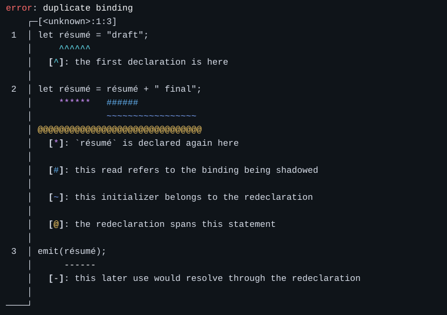

# Aldebaran

> [!WARNING]
> Project status: Pre-alpha / Experimental

[](https://github.com/wafkse/aldebaran/actions/workflows/build.yml)
[](https://github.com/wafkse/aldebaran/actions/workflows/test.yml)
[](LICENSE)
[](rust-toolchain.toml)

## Overview

### What Is Aldebaran?

Aldebaran is a Rust framework for writing lexers, parsers, and compiler diagnostics.
It includes tools for reading source text, recognizing tokens, storing names, and
showing errors with annotated source excerpts.

Use the `aldebaran` crate to access the framework, or choose individual crates for
an existing frontend.

### Goals

- Provide reusable building blocks for language frontends.
- Make source excerpts and useful error messages part of frontend development.
- Support custom input formats, token types, and storage.
- Support applications that run without the Rust standard library.

### Design Principles

Aldebaran supplies the machinery around a language's grammar. You define its
lexical types and syntax, then use the framework for source access, token streams,
and reporting.

Its components are separate libraries. For example, the diagnostic renderer can
be used with a handwritten parser, and token streams can read from either a lexer
or a stored token collection.

### Project Status and Scope

The project is pre-alpha and under active development. APIs may change, so pin a
tested revision when using it in another project.

The workspace focuses on frontend libraries. Language grammars, syntax trees,
semantic analysis, and code generation are supplied by the application.

## Features

### Source Handling

Read strings and byte slices through common source interfaces. Source views,
line information, and locations let a frontend associate tokens and errors with
the original input. Custom source types can implement the same interfaces.

### Lexing and Token Streams

Build lexical values with text cursors, character predicates, and speculative
reads. Token-stream adapters provide lookahead, filtering, and access to stored
tokens for the parser.

### Internment and Typed IDs

Store source values behind compact lookup keys with borrowed or owned storage.
Typed IDs let a frontend distinguish identifiers for different kinds of data, and
ID-keyed collections provide maps and sets for those values.

### Diagnostics and Reporting

Describe an error with a title and labeled source locations, then render it as an
annotated excerpt, a byte hexdump, or a compact summary. The optional `Report`
derive adds diagnostic and standard error support to application error types.

### Text and Terminal Rendering

Compose formatted output with colors and text attributes. Printing can use
external context, such as an interner, to resolve stored names directly into the
output. ANSI styling can be enabled or disabled for the destination.

## Quick Start

### Prerequisites

Install stable Rust and Git. The workspace uses Rust edition 2024. Rustfmt and
Clippy are also needed when contributing changes.

### Installation

Add the facade to an application's `Cargo.toml`.

```toml
[dependencies]
aldebaran = { git = "https://github.com/wafkse/aldebaran", branch = "development" }
```

For reproducible builds, replace `branch` with a tested `rev`. Applications that
need fewer components can depend on individual workspace crates instead.

### Minimal Example

This example consumes an identifier and inspects the remaining source component.

```rust
use aldebaran::text::prelude::{AsciiAlphabetic, AsciiAlphanumeric, Cursor};

fn main() {
    let mut cursor = Cursor::create("name42 +");

    let first = cursor
        .expect_is_next(AsciiAlphabetic)
        .expect("identifier start");

    cursor.ignore_while(AsciiAlphanumeric);

    assert_eq!(first, 'n');
    assert_eq!(cursor.peek(), Some(' '));
}
```

## Usage

### Source Processing

Start with a `Cursor` when scanning text. For direct source access, `SourceIter`
reads components, `SourceDissect` selects views, and `SourceLines` reads physical
lines. String positions use UTF-8 byte offsets.

The [source crate README](crates/aldebaran-source/README.md) introduces custom
source types.

### Building Compiler Frontends

Implement `Lex` for the values your lexer produces. Recognition returns the input
needed to construct a value, while construction can use shared state such as an
interner. A parser can therefore recognize an identifier before deciding to store
its name.

Use `TokenStream` to read tokens in the parser and its adapters to add lookahead
or skip tokens. See [text processing](crates/aldebaran-text/README.md) and
[token streams](crates/aldebaran-grammar/README.md) for the component APIs.

### Diagnostics and Error Reporting

Create a label for the relevant source location and pass it to a report. This
example marks the binding `x` and renders the diagnostic into a string.

```rust
use aldebaran::{
    baseline::span::Span,
    report::prelude::{Fancy, Label, RenderMut, Textual, oneshot},
};

fn main() {
    let label = Label::new("unused binding", Span::unit(4));
    let report = oneshot::single("let x = 1;", label);
    let mut output = String::new();
    let mut renderer = Textual::<'_, _, Fancy, _>::new(&mut output);

    renderer.render_mut(&report).expect("render diagnostic");

    assert!(output.contains("unused binding"));
}
```

### Rendering Output

Choose `Fancy` for source excerpts, `Hexdump` for byte sources, or `Summarized` for
compact output. The renderer writes to a formatting sink, so an application can
collect the result in a string before displaying or saving it.

The excerpt renderer supports color, character sets, layout settings, and a
configurable tab width.



### Feature Flags

The facade has no default features. Its optional features forward to component
crates.

| Facade feature | Capability |
| --- | --- |
| `report-codegen` | Derive support for report types |
| `source-storage` | Source-aware interner storage |

These switches enable additional functionality. Component crates may also enable
their own default features, including allocation support.

## Architecture

### Design Overview

A frontend uses source access and lexical recognition to produce tokens for its
parser. When it encounters an error, reporting and rendering turn that error into
a message with source context.

### Crate Organization

Each library covers a part of frontend development. The facade exposes them under
namespaces such as `aldebaran::text` and `aldebaran::report`, so applications can
use the same APIs through the facade or a direct dependency.

### Core Abstractions

| API | Used for |
| --- | --- |
| `Source` | Describing input and its components |
| `Cursor` | Scanning source input |
| `Span` | Referring to a range in the source |
| `Lex` | Defining lexical values |
| `TokenStream` | Reading tokens in a parser |
| `Report` | Describing a diagnostic |
| `SourceReport` | Presenting a diagnostic with its source |
| `Print` | Formatting values with external context |

### Data Flow and Component Boundaries

The usual path through a frontend is source input, lexical values, and then
application syntax nodes. Interning provides storage alongside these stages.
Diagnostics can be created wherever an error occurs and rendered when the
application is ready to display them.

A parser can also consume tokens from another producer, and a report can be
rendered without using Aldebaran's lexer.

### Dependency Relationships

`aldebaran-text` combines source access with predicates, storage, diagnostics, and
the token-stream interfaces from `aldebaran-grammar`. Reporting uses the source
and printing libraries, with terminal styling supplied by `aldebaran-ansi`.

The facade brings the runtime libraries together. Procedural macro crates provide
compile-time derives. See the [workspace manifest](Cargo.toml) for dependencies.

## Crates

### Facade Crate

| Crate | Purpose |
| --- | --- |
| [`aldebaran`](crates/aldebaran/README.md) | Combined access to framework components |

### Foundation and Identity

| Crate | Purpose |
| --- | --- |
| [`aldebaran-baseline`](crates/aldebaran-baseline/README.md) | Spans, nonempty collections, and shared primitives |
| [`aldebaran-id`](crates/aldebaran-id/README.md) | Typed IDs and ID-keyed collections |
| [`aldebaran-interner`](crates/aldebaran-interner/README.md) | Borrowed and owned value interning |

### Source Processing

| Crate | Purpose |
| --- | --- |
| [`aldebaran-source`](crates/aldebaran-source/README.md) | Source capabilities, locations, and line views |
| [`aldebaran-text`](crates/aldebaran-text/README.md) | Text cursors and lexical recognition |
| [`aldebaran-grammar`](crates/aldebaran-grammar/README.md) | Token streams and parser-facing adapters |

### Logic and Presentation

| Crate | Purpose |
| --- | --- |
| [`aldebaran-logic`](crates/aldebaran-logic/README.md) | Predicate assertions and typed classification |
| [`aldebaran-print`](crates/aldebaran-print/README.md) | Contextual printing and output composition |
| [`aldebaran-ansi`](crates/aldebaran-ansi/README.md) | ANSI color and text styling |

### Diagnostics

| Crate | Purpose |
| --- | --- |
| [`aldebaran-report`](crates/aldebaran-report/README.md) | Reports, annotations, and rendering backends |
| [`aldebaran-ice`](crates/aldebaran-ice/README.md) | Internal compiler error support |

### Procedural Macros

| Crate | Purpose |
| --- | --- |
| [`aldebaran-report-macro`](crates/aldebaran-report/aldebaran-report-macro/README.md) | Report derive |
| [`aldebaran-logic-macro`](crates/aldebaran-logic/aldebaran-logic-macro/README.md) | Assertion and selection derives |

## Compatibility

### Rust Toolchain

The repository selects stable Rust through [rust-toolchain.toml](rust-toolchain.toml).
A minimum supported Rust version has not been declared.

### `no_std` and `alloc`

Runtime crates support `no_std`, but several components use `alloc` and require an
allocator. The facade does not imply allocation-free operation. The baseline
crate's default `alloc` feature can be disabled when used directly.

### Platform Support

The build and test workflows cover Linux, macOS, and Windows with stable, beta,
and nightly Rust. Embedded and freestanding targets need separate validation for
the selected crates and features.

### Stability Guarantees

Pre-alpha APIs have no compatibility guarantee between revisions. Pin dependencies
and review API changes before upgrading.

## Development

### Repository Structure

`crates/` contains runtime libraries and nested procedural macro crates. `docs/`
contains shared documentation assets, and `.github/workflows/` defines CI.

### Building

```sh
cargo build --workspace --all-features
cargo check --workspace --all-targets --all-features
```

### Testing

```sh
cargo test --workspace --all-features
```

This includes unit tests, integration tests, and crate documentation examples.

### Linting and Formatting

```sh
cargo fmt --all -- --check
cargo clippy --workspace --all-targets --all-features -- -D warnings
RUSTDOCFLAGS='-D warnings' cargo doc --workspace --all-features --no-deps
cargo dylint --all -- --workspace --all-targets --all-features
```

Dylint requires `cargo-dylint`, the library selected in [dylint.toml](dylint.toml),
and that library's compiler toolchain.

### Continuous Integration

[CI](.github/workflows/ci.yml) checks formatting, compilation, Clippy, tests, and
rustdoc on stable Rust for pull requests and pushes to `development`. Separate
[build](.github/workflows/build.yml) and [test](.github/workflows/test.yml) workflows
provide the operating-system and toolchain matrix on development pushes.

## Design Decisions

### Architectural Decisions

Token producers and parsers communicate through a shared stream interface. This
allows a parser to use a live lexer during normal operation and stored tokens in
other contexts.

Printing takes external context so stored names can be formatted through an
interner. Applications can keep compact IDs in their data rather than copying
names into each value.

### Trade-offs

Custom source and token types make the framework adaptable, but implementing a
frontend requires more setup than using a lexer for a fixed language. Separate
crates allow smaller integrations, while the facade is convenient for applications
using several components.

### Known Limitations

Applications provide their own grammar and syntax tree. The grammar crate
currently supplies token-stream interfaces and adapters for that work.

Unicode display width can vary between terminals, so rendered alignment depends
on the destination. See the component documentation for details about source
positions and error handling.

## Roadmap

A release schedule has not been published. Proposals for language integrations,
missing functionality, and API improvements can be discussed through
[issues](https://github.com/wafkse/aldebaran/issues).

## Contributing

### Development Guidelines

Build and test the affected crates before submitting a change. Include examples
for new APIs and regression tests for bug fixes. If a change affects how a crate
is used, update its documentation alongside the code.

### Issues and Bug Reports

Use [GitHub issues](https://github.com/wafkse/aldebaran/issues) to report defects.

Include the revision, toolchain, enabled features, and a minimal reproducer with
expected and actual behavior.

### Pull Requests

Open [pull requests](https://github.com/wafkse/aldebaran/pulls) against `development`.

Explain the resulting behavior and any API changes, and include relevant validation.

Run the development checks before submitting.

## License

Copyright (C) 2026 W. Frakchi. Licensed under AGPL-3.0-or-later.
See [LICENSE](LICENSE) for the license text.
